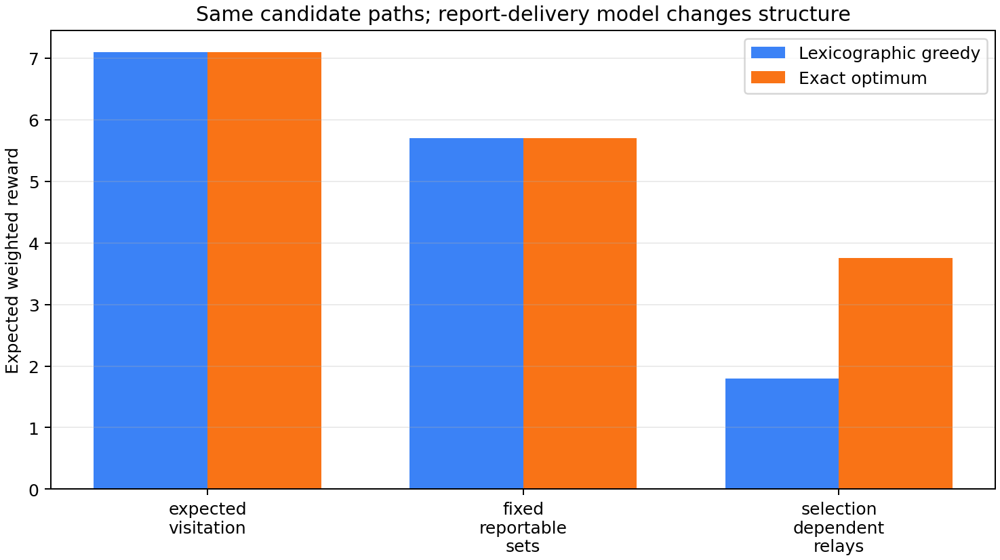

# Reportability under relay dependence

Date: 15 October 2026  
Author: Dhyan Ishwar Shaji  
Status: independent exact structural mechanism tests; not a reproduction of the IJRR implementation and not affiliated with Stanford University or the paper's authors

This repository tests a narrow question motivated by Jorgensen and Pavone's
Matroid Team Surviving Orienteers (MTSO) formulation: what changes when a
route's sensed targets become reportable only through other selected routes?

## Main result: MTSO-aligned candidate paths

`mtso_aligned_reportability.py` freezes six source-to-terminal candidate paths
on a discrete graph, a rank-3 uniform matroid, a survival threshold of 0.8,
weighted targets, five shared hazard scenarios, and time-synchronous radio
geometry. Every route satisfies the survival threshold. All 64 route subsets
and all 1,458 diminishing-returns inequalities are evaluated exactly.

The same path library is scored three ways:

1. **Expected visitation:** weighted targets physically visited by at least one
   surviving robot, analogous to the MTSO reward.
2. **Fixed reportable sets:** every route has a scenario-dependent reportable
   target set fixed independently of the other selected paths.
3. **Selection-dependent relays:** a detecting robot delivers its report only
   when the selected, surviving paths create a same-time radio chain to base.

| Objective | DR inequalities | Violations | Minimum slack | Greedy | Exact optimum | Ratio |
|---|---:|---:|---:|---:|---:|---:|
| Expected visitation | 1,458 | 0 | 0 | 7.10 | 7.10 | 1.00 |
| Fixed reportable sets | 1,458 | 0 | 0 | 5.70 | 5.70 | 1.00 |
| Selection-dependent relays | 1,458 | 324 | −1.95 | 1.80 | 3.75 | 0.48 |

The minimal geometry-backed relay witness is:

- adding `east_scout` to the empty set has marginal value 0;
- adding it after `east_relay` has expected marginal value 1.95.

Thus the shared hazard distribution is not the structural break in this
fixture. The break occurs because another selected path changes whether a
scout's already-collected observation becomes deliverable.



### Bundle lift

The script also checks the proposed lift from individual paths to complete
detector–relay policies. Fixed target coverage over bundles is submodular
(0/27 violations). However, when two bundles may not reuse a physical route,
the bundle-feasibility family fails the matroid exchange axiom. The exact
witness is:

- feasible smaller set: `{bundle_23}`;
- feasible larger set: `{bundle_12, bundle_34}`;
- neither element of the larger set can augment the smaller set because each
  shares one physical route with `bundle_23`.

This does not prove every possible lift loses a matroid representation. It
shows that the most direct bundle lift can move the difficulty from the reward
function into a non-matroidal set-packing constraint.

## Earlier minimal audit

### Question tested

Does shared hazard correlation itself destroy diminishing returns in expected
reported coverage, or is the structural break caused by report delivery that
depends on which other routes are selected?

### Frozen toy model

The ground set contains four candidate routes, `A`–`D`, and every one of the
16 route subsets is evaluated.

### Case 1: shared exogenous hazard

A single team-wide hazard state is drawn from four states: clear,
west blackout, east blackout, or global blackout. Route outcomes are therefore
correlated. Conditional on the state, however, each route has a fixed
reportable-target set that does not depend on the other selected routes. The
objective is the expected cardinality of the union of those sets.

### Case 2: selection-dependent relays

Route `A` detects `t1` and route `D` detects `t3`, but neither can deliver its
report unless relay route `B` is also selected. Route `C` independently
self-delivers `t2`. Delivery therefore depends on the selected route set.

### Exact result

The script uses rational arithmetic and checks all diminishing-returns
inequalities of the form

`F(S ∪ {e}) - F(S) >= F(T ∪ {e}) - F(T)` for `S ⊆ T` and `e ∉ T`.

| Model | Inequalities checked | Violations | Minimum slack |
|---|---:|---:|---:|
| Shared exogenous hazard | 108 | 0 | 0 |
| Selection-dependent relay | 108 | 33 | -2 |

A minimal relay witness is

- `F(∅) = 0`
- `F({A}) = 0`
- `F({B}) = 0`
- `F({A,B}) = 1`

Thus the marginal value of adding `A` is zero without `B` and one after `B`
is selected. A stronger witness in this four-route fixture gives relay `B` a
marginal value of zero at the empty set and two after both detecting routes
`A` and `D` are present.

### Interpretation

This exact toy check supports the distinction used in the Pavone email:

1. Correlation from a shared exogenous hazard is not, by itself, sufficient to
   destroy submodularity when every route's random reportable set is fixed
   independently of the selected team.
2. Selection-dependent relay opportunities create complementarity and can
   violate submodularity immediately.
3. A possible lift is to make a complete coordinated team policy or
   detector–relay bundle one ground element with a fixed random reportable set.
   Coverage can then be submodular over bundles, but route-sharing,
   prerequisites, and resource constraints may cease to be a matroid or even
   a simple downward-closed family. The lift therefore moves rather than
   automatically solves the optimization difficulty.

## Limits

- These are structural counterexamples and sanity checks, not a theorem about
  all communication-aware routing objectives.
- It does not reproduce the Stanford companion code, which implements selected
  algorithmic routines rather than a complete MTSO solver.
- It does not connect the IECON simulator to route-level report delivery.
- The MTSO-aligned instance is intentionally small enough for complete exact
  enumeration; it is not a performance benchmark.
- The route geometry, hazard probabilities, reward weights, greedy tie-break,
  and communication model are declared experimental choices.
- These results support a concise, inspectable follow-up only after the code is
  independently reviewed and published at a stable public URL.

## Reproduction

Run both exact checks:

```bash
python3 mtso_reportability_pilot.py
python3 mtso_aligned_reportability.py
python3 -m unittest -v test_mtso_aligned_reportability.py
```

The aligned run also writes `mtso_aligned_results.json`,
`mtso_aligned_summary.csv`, and `mtso_aligned_objectives.png`.

## Sources

- S. Jorgensen and M. Pavone, “The matroid team surviving orienteers problem
  and its variants: Constrained routing of heterogeneous teams with risky
  traversal,” *The International Journal of Robotics Research*, 43(1), 2024,
  DOI: 10.1177/02783649231210326.
- StanfordASL/MTSOExamplesIJRR23, public companion repository. Its README
  explicitly states that it is not a complete implementation of the paper's
  algorithm.
